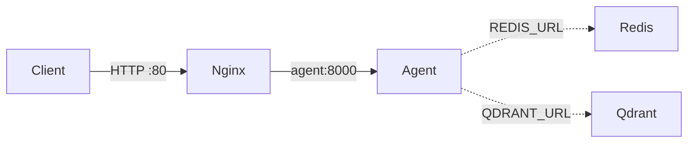

# Day 14 Lab — Mission Answers

Ngày thực hành: 25/11/2026 (GMT+7). Bài làm theo các điều chỉnh K5 trong README và CHECKPOINTS.
Các kết quả dưới đây do công cụ thực thi thu thập thật; không lấy số minh họa trong tài liệu làm kết quả.

| Checkpoint | Trạng thái |
|---|---|
| CP0 — Setup | Hoàn tất, repo public và Docker/Python Linux hoạt động |
| CP1 — Part 1 | Hoàn tất |
| CP2 — Docker | Hoàn tất |
| CP3 — Security | Hoàn tất |
| CP4 — Scaling/reliability | Hoàn tất |
| CP5 — Part 6 | PASS 12/12, 43/43 checks |
| CP6 — Cloud | Hoàn tất Railway + Redis, public HTTP 200/200/401/200 |
| CP7 — Benchmark local | Hoàn tất, eval cuối 23/23 |
| CP8 — Observability và hồ sơ local | Hoàn tất số đo/ảnh/báo cáo; chưa nộp link lên LMS |

## CP0 — Setup

- Repo làm việc: bản clone từ remote `worryveem/K5-L3A-DAY14-DoMinhHoang-2A202603554-Deployment-Benchmark-Observability`.
- Máy Windows có Docker Desktop dùng WSL2; chưa có distribution Ubuntu/Python trong WSL.
- Đã chạy Python Linux 3.11.18 trong container trên WSL2, `os.name = posix`.
- `docker run --rm hello-world`: xem [output](evidence/part0-docker-hello.txt).
- Không cần key LLM thật. Thông tin môi trường được ghi ở [evidence](evidence/docker-environment.json).

## Part 1 — Localhost vs Production (CP1)

### Exercise 1.1 — Anti-patterns trong develop/app.py

| Vị trí | Vấn đề | Hậu quả và cách xử lý |
|---|---|---|
| Dòng 17 | API key hardcode (key giả trong ví dụ) | Key thật sẽ nằm trong repo/lịch sử Git; lấy từ environment/secret store |
| Dòng 18 | URL DB chứa tài khoản/mật khẩu và localhost | Lộ credential, phụ thuộc máy chạy; đưa connection string ra env |
| Dòng 21–22 | DEBUG/MAX_TOKENS cố định | Không đổi cấu hình theo môi trường bằng cùng artifact được |
| Dòng 33–38 | Dùng print; dòng 34 in cả key | Khó lọc log, phát tán secret; log có cấu trúc và loại bỏ credential |
| Các route dòng 25–39 | Thiếu /health và /ready | Hệ thống vận hành thiếu endpoint để kiểm tra sống/sẵn sàng |
| Dòng 51 | Bind localhost | Không nhận kết nối tới địa chỉ mạng container từ bên ngoài |
| Dòng 52 | Port luôn là 8000 | Không sử dụng PORT do cloud inject |
| Dòng 53 | reload=True cố định | Chạy reloader không cần thiết trong production |
| Toàn file | Không có lifespan cleanup của app | Chưa có chỗ đóng connection/flush tài nguyên khi tắt |

Không kết luận mọi lần tắt develop đều đột ngột: Uvicorn vẫn có shutdown mặc định.
Thiếu ở bản develop là lifecycle/cleanup riêng của ứng dụng.

### Exercise 1.2 — Chạy basic version

Đã cài dependencies và chạy nguyên `python app.py` trong container Linux, rồi gọi HTTP thật bên trong container
(cần gọi nội bộ vì ví dụ bind localhost). Không chỉnh code mẫu Part 1.

```bash
cd 01-localhost-vs-production/develop
pip install -r requirements.txt
python app.py
# Terminal khác, cùng môi trường mạng:
curl -i -X POST 'http://localhost:8000/ask?question=Hello'
```

Kết quả thực tế: HTTP 200, `answer`: Tôi là AI agent được deploy lên cloud. Câu hỏi của bạn đã được nhận.

| Request develop | HTTP |
|---|---:|
| GET / | 200 |
| POST /ask?question=Hello | 200 |
| POST /ask?question=What%20is%20Docker%3F | 200 |
| POST /ask với JSON question, không có query | 422 |
| GET /health | 404 |
| GET /ready | 404 |

Develop nhận `question` qua query; JSON-only bị 422 vì FastAPI báo thiếu query parameter.
Log có dòng `Using key`, đã che giá trị cả khi chỉ là key giả. Toàn bộ request/response và log:
[evidence/part1/runtime.json](evidence/part1/runtime.json).

### Exercise 1.3 — Bảng so sánh

| Feature | Develop | Production mẫu | Tại sao quan trọng? |
|---|---|---|---|
| Config | Hằng số trong app.py | Settings đọc os.getenv trong config.py | Một artifact dùng được qua dev/staging/production |
| Secrets | Key/DB credential hardcode và key bị in log | Lấy key từ env, log chỉ độ dài câu hỏi | Tránh đưa credential vào source và log |
| Network/port | localhost:8000 | HOST mặc định 0.0.0.0, PORT từ env | Nhận traffic ngoài container và theo port cloud |
| Reload | Luôn bật | Theo DEBUG, mặc định false | Production không chạy file watcher |
| Liveness | Không có /health | /health có uptime, version, environment | Cho nền tảng kiểm tra process |
| Readiness | Không có /ready | Cờ is_ready trong lifespan | Chỉ route traffic khi instance sẵn sàng |
| Logging | print, có key | Có ý định log JSON, không log key | Thuận tiện truy vấn log; xem hạn chế thực tế bên dưới |
| Shutdown | Không có cleanup riêng | lifespan startup/shutdown | Quản lý vòng đời và dọn tài nguyên |
| Input | Query question | JSON question; rỗng trả 422 | Hợp đồng request rõ hơn |
| CORS | Không cấu hình | Danh sách origin từ env | Giới hạn truy cập từ JavaScript trên trình duyệt |

Đã chạy bản production với PORT=8001, ENVIRONMENT=production, DEBUG=false và key tạm qua env.
GET /, /health, /ready và POST /ask hợp lệ đều 200; JSON thiếu question trả 422.
SIGTERM sau các request làm process thoát mã 0. Đây chưa phải thí nghiệm in-flight (thí nghiệm đó ở Part 5/6).

Những giới hạn quan sát được của bản mẫu: warning trong config.py được ghi trước basicConfig nên root logger
đã có handler; lần chạy này chưa xuất hiện log JSON của app. /ready chỉ kiểm cờ, chưa ping dependency.
AGENT_API_KEY được validate trong config nhưng chưa gắn auth vào /ask (gọi không header vẫn 200).
File .env không tự được nạp chỉ vì có python-dotenv trong requirements; dùng env thực hoặc loader rõ ràng.
/metrics ở Part 1 trả JSON đơn giản, chưa phải exposition format Prometheus như Part 7.

Thảo luận: public key thật có thể bị quét và lạm dụng, cần revoke/rotate chứ xóa file chưa đủ.
Stateless quan trọng vì mỗi instance có RAM riêng; state chung phải ở Redis/DB.
Dev/prod parity nghĩa là giữ runtime, dependency và backing service gần nhau, với cấu hình khác qua env.

## Part 2 — Docker (CP2)

### Exercise 2.1

1. Base image: `python:3.11`; đây là Python runtime và các thư viện hệ điều hành làm nền image.
2. Working directory: `/app`; các lệnh COPY/RUN/CMD với đường dẫn tương đối dựa vào đây.
3. COPY requirements trước source để Docker tái sử dụng layer cài dependency khi chỉ code thay đổi.
4. CMD đặt lệnh/đối số mặc định, dễ bị thay bởi đối số docker run. ENTRYPOINT đặt executable chính;
   với exec form, đối số docker run thường thay CMD và được nối vào ENTRYPOINT. Dùng exec form để chuyển signal đúng.

### Exercise 2.2–2.3 — Build và đo image

```bash
# Từ gốc repo:
docker build -f 02-docker/develop/Dockerfile -t my-agent:develop .
docker build -f 02-docker/production/Dockerfile -t my-agent:advanced .
docker image inspect my-agent:develop my-agent:advanced --format '{{.RepoTags}} {{.Size}}'
```

| Image | Bytes thực đo | MiB (bytes / 1024²) |
|---|---:|---:|
| Develop | 1667788048 | 1590.53 |
| Production | 239819608 | 228.71 |

Giảm **85.62%**, tính `(develop - production) / develop × 100`.
Stage builder cài compiler/dependencies; runtime chỉ lấy packages đã cài và source cần chạy.
Không mang gcc, header và layer build sang image cuối; base slim cũng nhỏ hơn bản Python đầy đủ.
Hai container riêng đã trả 200 khi gọi agent; [kết quả](evidence/part2/runtime.json).

### Exercise 2.4 — Stack và giao tiếp



Đã chạy `docker compose -p k5-day14-docker up -d` tại thư mục production, có `.env.local` trống được ignore.
Stack gồm agent, Redis, Qdrant, Nginx trên mạng internal; DNS service name dùng cho giao tiếp nội bộ.
Các biến REDIS_URL/QDRANT_URL chuẩn bị đường kết nối; app mẫu chưa thực hiện retrieval/session qua chúng.
GET /health và POST /ask qua Nginx cổng 80 đều 200, xem file runtime ở trên. Redis/Qdrant có named volume.
Healthcheck đánh dấu container unhealthy; Docker restart policy không tự restart chỉ vì unhealthy.

## Part 3 — Cloud Deployment (CP6)

Đã deploy chính agent Part 6 lên Railway bằng tài khoản mới, kèm Redis trên mạng nội bộ.
Public URL: [https://day14-agent-production-a76b55eb.up.railway.app](https://day14-agent-production-a76b55eb.up.railway.app).
Bốn kiểm tra public thực tế: GET /health 200, GET /ready 200, POST /ask thiếu key 401, có key 200.
Xem [public-api.json](evidence/part6/public-api.json), [trạng thái Railway](evidence/part6/railway-deployment.json) và [DEPLOYMENT.md](DEPLOYMENT.md). Ba ảnh deploy đã bổ sung; dashboard.png là bản xuất trạng thái Railway CLI.

| Railway TOML | Render YAML |
|---|---|
| builder=DOCKERFILE, dùng context Part 6 | web runtime=docker, rootDir=06-lab-complete |
| healthcheckPath=/health | healthCheckPath=/health |
| Tạo Redis service và REDIS_URL qua platform | Blueprint mô tả keyvalue và fromService connectionString |
| Secret đặt ngoài TOML | AGENT_API_KEY dùng generateValue, không ghi giá trị |

Exercise 3.3 — Cloud Run CI/CD (đọc cấu hình, không deploy GCP):

1. Cloud Build cài dependency và chạy pytest trước bước build.
2. Docker build image gắn COMMIT_SHA/latest, tận dụng layer cache.
3. Push image lên registry để môi trường chạy tải được đúng artifact.
4. gcloud run deploy dùng image COMMIT_SHA, region asia-southeast1, env và Secret Manager.
5. service.yaml mô tả concurrency 80, min/max instance 1/10, resource limit và probe /health, /ready.

Lưu ý thực tế: step shell test trong mẫu nên có `set -e` để lệnh echo cuối không che exit code pytest thất bại.

## Part 4 — API Security (CP3)

### Exercise 4.1–4.3

Đã chạy API-key sample và JWT sample riêng trên cổng 8014 để tránh xung đột.
API key tạm được truyền bằng env; JWT lấy ở POST /auth/token bằng user mẫu student/demo123, không lưu token.
Kết quả: API key thiếu → 401, đúng → 200; JWT thiếu → 401; burst 12 request có
**10 lần 200 và 2 lần 429**. Header Retry-After có trong response 429.

Output thật từ curl -i (không có credential trong request được lưu):

```http
Missing API key:
HTTP/1.1 401 Unauthorized
date: Wed, 25 Nov 2026 08:37:08 GMT
server: uvicorn
content-length: 67
content-type: application/json

{"detail":"Missing API key. Include header: X-API-Key: <your-key>"}

Valid API key (request header redacted):
HTTP/1.1 200 OK
date: Wed, 25 Nov 2026 08:37:08 GMT
server: uvicorn
content-length: 123
content-type: application/json

{"question":"Docker","answer":"Container là cách đóng gói app để chạy ở mọi nơi. Build once, run anywhere!"}

JWT rate limit (request token redacted):
HTTP/1.1 429 Too Many Requests
date: Wed, 25 Nov 2026 08:37:11 GMT
server: uvicorn
x-ratelimit-limit: 10
x-ratelimit-remaining: 0
x-ratelimit-reset: 1795595891
retry-after: 59
content-length: 98
content-type: application/json
x-content-type-options: nosniff
x-frame-options: DENY
x-xss-protection: 1; mode=block
referrer-policy: strict-origin-when-cross-origin

{"detail":{"error":"Rate limit exceeded","limit":10,"window_seconds":60,"retry_after_seconds":59}}
```

Rate limiter mẫu dùng sliding-window log: deque timestamp, loại các request quá 60 giây rồi đếm phần còn lại.
Student 10 request/phút; admin 100 request/phút. Admin có hạn mức cao hơn, **không được bypass hoàn toàn**.
State in-memory trong ví dụ chỉ phù hợp demo; Part 6 chuyển sang Redis để nhiều worker chia sẻ và chống reset khi restart.
API-key sample trả 403 khi key sai, khác yêu cầu Part 6 là thiếu/sai đều 401.

### Exercise 4.4 — Cost guard

Rate limit hạn chế tốc độ gọi, không biết mỗi request dùng bao nhiêu token. Cost guard cộng chi phí token input/output
và chặn khi hết ngân sách, nên cần cả hai. Với ngân sách $10/tháng cho mỗi user, dùng Redis key chứa user + tháng UTC,
kiểm `current + estimated_cost <= 10` và ghi nhận reservation nguyên tử bằng Lua; đặt TTL đủ dài qua kỳ quyết toán.
Kỳ mới dùng key mới; sau khi gọi model cần reconcile reservation với usage thật.

Theo K5, Part 4 chạy và giải thích code mẫu: mẫu dùng budget ngày trong RAM, user vượt trả 402, global vượt trả 503.
Phần triển khai nộp Part 6 dùng Redis với budget ngày/tháng toàn service, vượt trả 402, chi phí mock ước lượng theo ký tự.
Giới hạn còn lại: check trước và record sau chưa reserve ngân sách cho request đồng thời; chi phí có thể vượt thêm bởi
các request đã được chấp nhận. Production thật cần reservation nguyên tử như mô tả trên.

## Part 5 — Scaling & Reliability (CP4)

Exercise 5.1: /health là liveness, không phụ thuộc Redis. /ready là readiness và phải 503 khi dependency chưa sẵn sàng.
Ví dụ develop dùng cờ; agent Part 6 ping Redis với timeout. Khi Redis chết, restart mọi agent không sửa được Redis,
nên /health vẫn 200 để tránh restart loop, trong khi /ready ngăn route request vào instance không sẵn sàng.

Exercise 5.2: đã gửi request rồi SIGTERM trong khi request còn xử lý. Request trả **200**;
process kết thúc, return code thực tế của Uvicorn CLI ví dụ là **-15** trên Linux.
Đã sửa handler logging-only trong mẫu vì nó thay handler Uvicorn khi import qua CLI và làm process không thoát.
Cleanup nằm trong lifespan; không dùng SIGKILL cho đường tắt bình thường.
Part 6 có kiểm tra mạnh hơn: in-flight 200, exit 0, Docker stop 1 giây; xem checklist bên dưới.

Exercise 5.3: state trong RAM làm các instance thấy các history khác nhau. Redis là backing service chung nên
instance nhận request tiếp theo vẫn đọc được session. Scale agent không đòi sticky session để giữ history.

Exercise 5.4–5.5: đã chạy 3 instance với project k5-day14-scaling, Nginx cổng 8080, POST /chat;
script gốc gửi 5 request cùng session qua **3 instance** và đọc đủ **10 message** (5 user + 5 assistant).
Script không tự kill instance, vì vậy không dùng kết quả này để khẳng định đã kiểm thử failover.
[Output nguyên bản](evidence/part5/stateless.txt), [health/shutdown](evidence/part5/health_shutdown.json).

## Part 6 — Final Project (CP5)

Làm trực tiếp trong 06-lab-complete/app. Auth so sánh key constant-time; rate limit sliding window dùng Redis TIME,
sorted set và Lua nguyên tử; key được hash trước khi làm Redis key. Cost ngày/tháng lưu Redis có TTL.
Đã hoàn thiện Dockerfile multi-stage, non-root, HEALTHCHECK, PORT, Compose Redis và hai cấu hình cloud.
Redis không cần hoạt động lúc import/startup; lỗi khi xử lý state trả 503 không lộ connection string/stack trace.

Lệnh chấm đầy đủ chạy bằng Python Linux với Docker daemon thực, script chấm không sửa:

```bash
cd 06-lab-complete
python check_production_ready.py
```

```text
📋 Checklist Deliverable
     ✅ Dockerfile (multi-stage, < 500 MB)
     ✅ docker-compose.yml (agent + redis)
     ✅ .dockerignore
     ✅ Health check endpoint (GET /health)
     ✅ Readiness endpoint (GET /ready)
     ✅ API Key authentication
     ✅ Rate limiting
     ✅ Cost guard
     ✅ Config từ environment variables
     ✅ Structured logging
     ✅ Graceful shutdown
     ✅ Public URL ready (Railway / Render config)
----------------------------------------------------------------
  Result: 12/12 tiêu chí đạt · 43/43 checks passed
  🎉 PASS 12/12 — PRODUCTION READY! Deploy nào!
================================================================
```

Log đầy đủ: [readiness.txt](evidence/part6/readiness.txt). Image 238 MiB theo script chấm.
Kiểm tra bổ sung Compose: input rỗng, toàn khoảng trắng, sai kiểu đều 422; health/ready 200, thiếu key 401.
20 request đồng thời qua 2 worker cho đúng 10 lần 200 và 10 lần 429:
[api-validation.json](evidence/part6/api-validation.json).
Ngoài PASS 12/12 local, URL Railway đã qua đủ bốn kiểm tra public; xem DEPLOYMENT.md và evidence/part6/public-api.json.

## Part 7 — Benchmark & Observability (CP7–CP8)

Xem [BENCHMARK_REPORT.md](BENCHMARK_REPORT.md), các JSON trong reports, CSV trong benchmark-results và ảnh screenshots.
Đã bổ sung Histogram agent_question_length_chars, không dùng độ dài câu hỏi làm label.
Không sửa golden_dataset.jsonl hoặc check_production_ready.py.

## AI log

| Yêu cầu gửi AI | Kết quả AI cung cấp | Sửa và kiểm tra thực tế |
|---|---|---|
| Đọc lab, giải thích các bước | Đối chiếu tài liệu K5 và lập thứ tự checkpoint | Đọc README/RULES/CHECKPOINTS/SUBMISSION/RUBRIC và code mẫu |
| Làm Part 1, sau đó toàn bộ checkpoint/part | AI viết code Part 6, metric/KB/CI, sửa 2 lỗi mẫu, thu thập và tổng hợp báo cáo | AI trực tiếp chạy HTTP, Docker build/Compose, script chấm gốc, eval/load/Locust, promtool và browser screenshot; đường dẫn bằng chứng đi kèm từng phần |
| Chọn Railway rồi chuyển Render | Chuẩn bị cấu hình deploy và thực hiện login CLI | Railway bị chặn bởi trial hết hạn; trạng thái thật của cloud ghi trong DEPLOYMENT.md |
| Hoàn tất deploy Railway bằng tài khoản mới | AI tạo project/Redis/agent, đặt env, upload code và tạo public domain | Kiểm tra live HTTP 200/200/401/200, Redis nội bộ và hai service SUCCESS; lưu JSON và ảnh từ CLI/public API, không lưu secret vào Git |

Các thao tác tự động trên do AI thực hiện trong workspace. Chưa có xác nhận người học đã tự đọc hiểu từng đoạn code;
người học cần đối chiếu code và bằng chứng trước khi nộp/giải thích với Lab Coach. Không khai các thao tác AI là tự làm tay.
